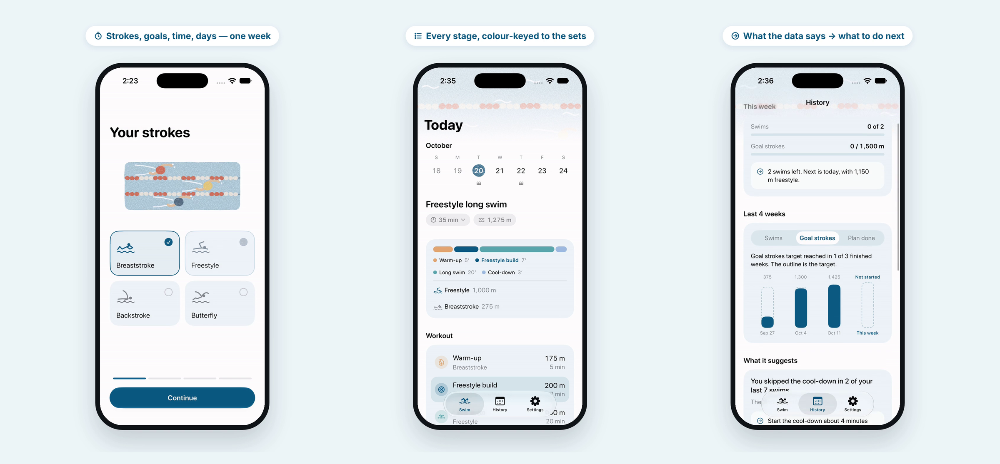
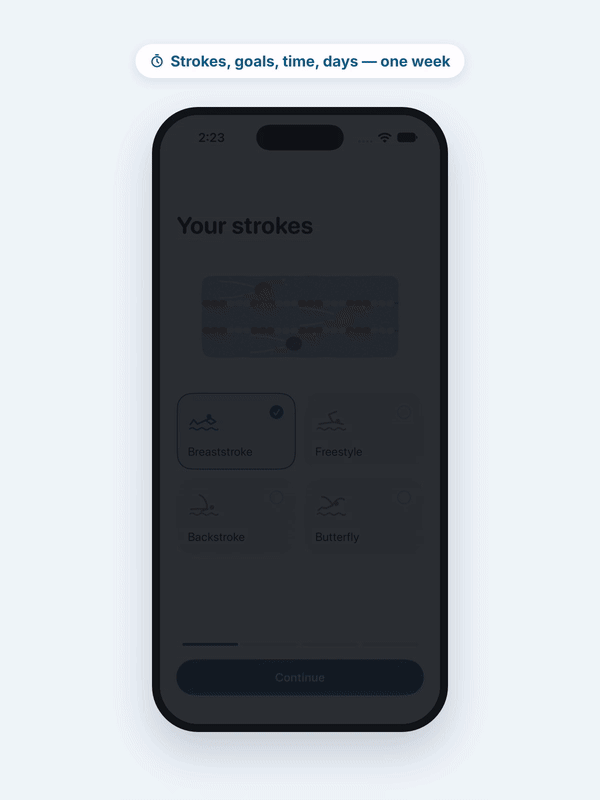
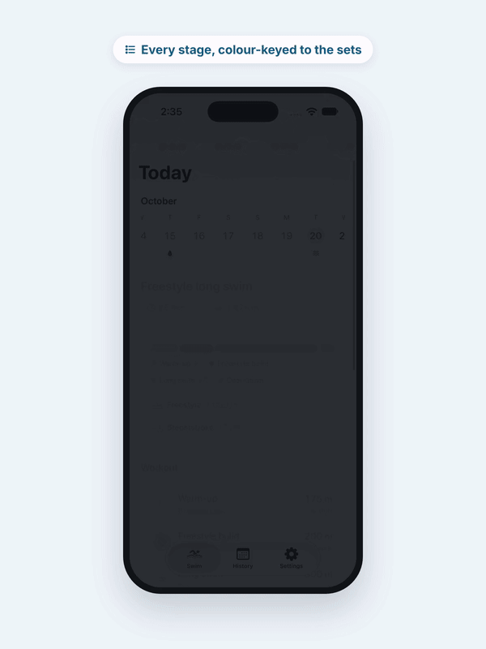
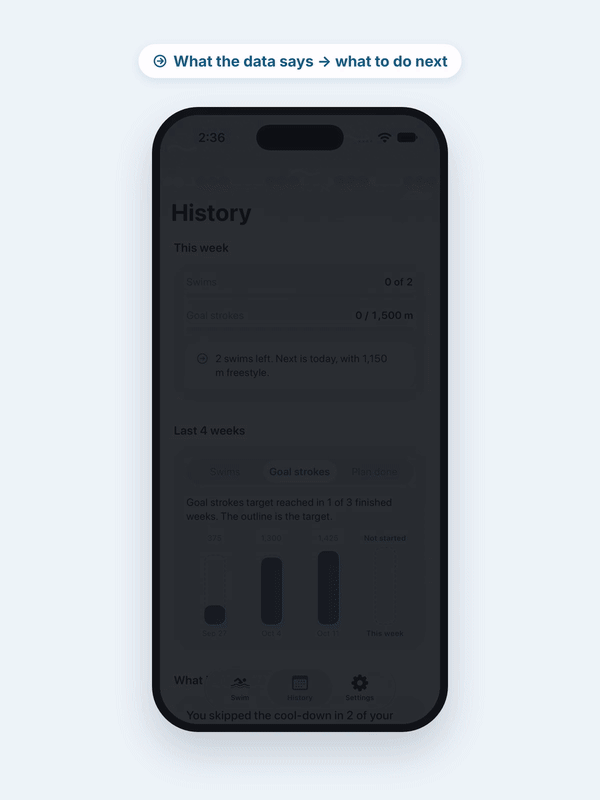

# Swim Balance

Swim Balance is a working SwiftUI prototype created for the Palantir Product Design Show & Tell. It helps me turn long-term swimming goals, limited daily time, and completed workout data into a realistic plan for the next swim.



**Video walkthrough:** https://www.youtube.com/watch?v=OFN8XVHJ8wQ

## The problem

I swim regularly. Breaststroke is my comfort zone, and I'm working on my freestyle while still trying to swim enough overall to stay active. Those two goals pull against each other — freestyle practice is slower, so the more time I give it, the less distance I cover — and my time at the pool changes from day to day.

My Apple Watch records what happened in each swim (distance, time, pace, strokes), but it doesn't help me decide what to swim today or what to change next time. Swim Balance closes that gap with a simple loop:

1. **Plan** — set the strokes I swim, what I'm working on, my usual time and swim days. The app builds a week of sessions that fit.
2. **Swim** — each session is laid out as colour-keyed stages. If I have more or less time on a given day, I change it and the session rebalances around the focus stroke.
3. **Reflect & adjust** — after a swim I get a short takeaway and one next step. Two quick questions (how hard it felt, why I stopped) shape that suggestion. History shows each week against its target.

| Plan | Swim | Reflect |
| --- | --- | --- |
|  |  |  |

## Requirements

- macOS with **Xcode 27.0** or later
- iOS **26.0** or later (deployment target), run in the iPhone Simulator
- No third-party dependencies, no Apple Developer account needed for the Simulator

## Run it

1. Clone the repo and open `SwimBalance.xcodeproj` in Xcode.
2. Select the **SwimBalance** scheme and any iPhone simulator running iOS 26 or later.
3. Press **Run** (⌘R).

On first launch the app walks through a short setup (strokes, goal, time, swim days). To see the setup again, use **Settings → Reset**.

## Data

**All workout data in this prototype is simulated.** `MockSwimmingWorkoutService` generates about eight weeks of sample swims shaped like what Apple Watch records (distance, duration, per-set strokes), matched to the current plan so History has something meaningful to show. No Apple Watch export or HealthKit data is used.

Preferences, one-day time changes and reflection answers are stored locally with `UserDefaults`.

## Scope and limitations

- HealthKit is not connected. `HealthKitSwimmingService` is a placeholder behind the same protocol as the mock service, so real data can be swapped in later.
- iPhone only, English only, portrait layout.
- Plan and feedback rules are simple heuristics I wrote for my own swimming, not coaching advice.
- No Apple Watch app, sync, accounts or automated tests.

## Project structure

```
SwimBalance/
├── SwimBalanceApp.swift, ContentView.swift   App entry and tabs (Swim, History, Settings)
├── Models/       Swim domain models (preferences, sets, workouts, reflections)
├── Data/         TrainingStore (local persistence) and mock workout data
├── Services/     PlanGenerator (sessions and feedback) and the HealthKit seam
├── Features/     Setup, Today (Swim), History, Settings, shared components and theme
└── Assets.xcassets  Illustrations and app icon
```

## How AI was used

The prototype was designed and built in about three hours:

- **ChatGPT** — framing the problem and constraints (~20 min), and cross-checking ideas during iteration.
- **Muse 5.0** — generating the first SwiftUI project, data models and plan logic (~15 min).
- **Claude Code + Xcode** — the remaining ~2.5 hours of critique, refinement and testing in the Simulator.

I decided what to build, reviewed and tested everything in the Simulator, and made the product and design calls.

## What's next

- Read real swimming workouts from HealthKit.
- An Apple Watch companion so each set can be followed from the wrist.

## Author

Phoebe (Longyue) Qin · Portfolio: https://qinlyismoon.github.io/
